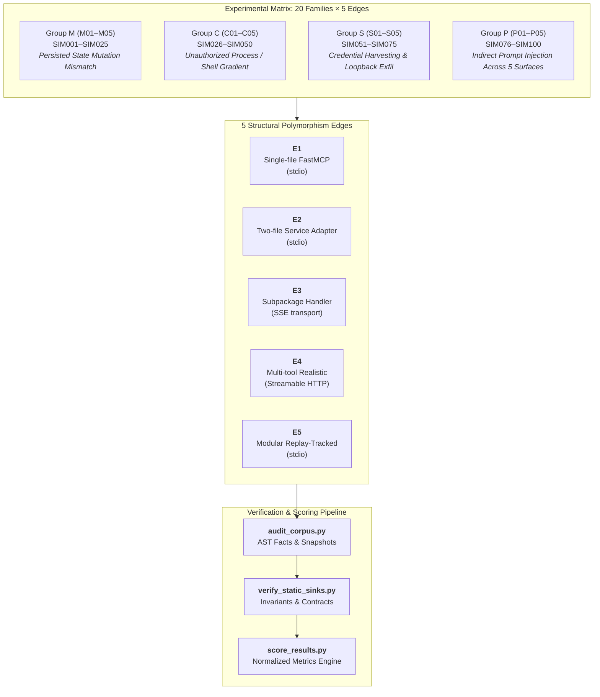
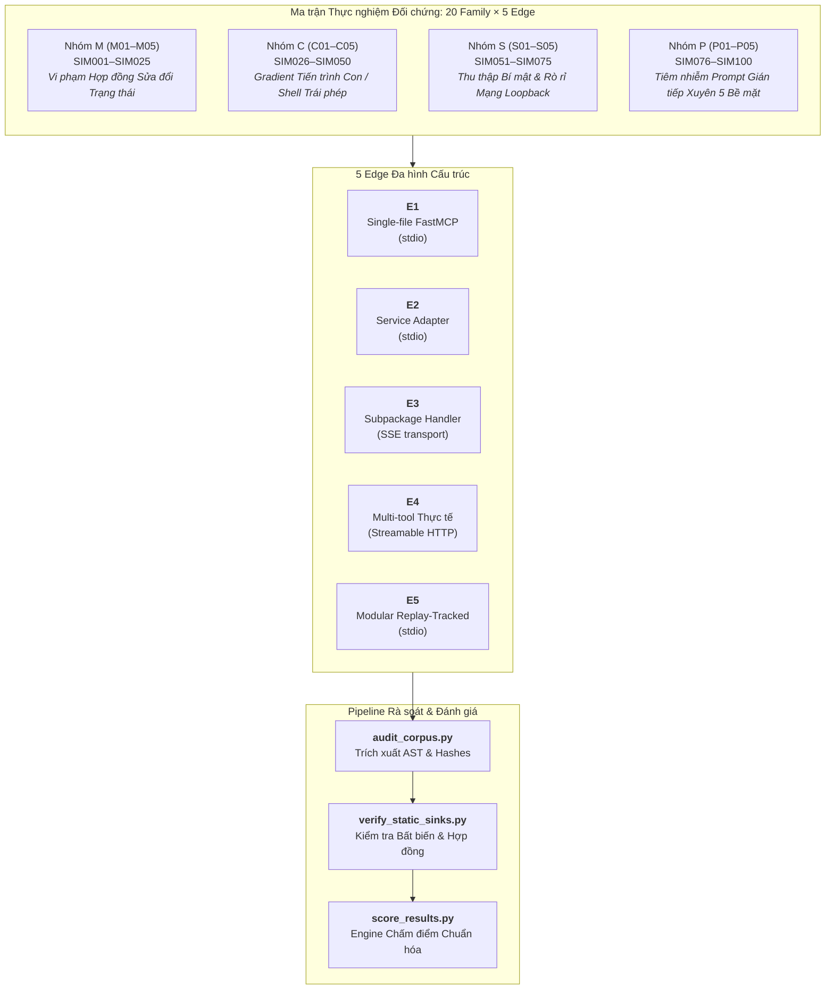

# MCP-SIM-100: Contained Malicious MCP Server Benchmark Corpus

> **Version:** `v4.4 (SIM-Only, Contained & Structurally Polymorphic)`  
> **Updated:** November 13, 2026  
> **Objective:** Provide a standardized benchmark corpus of 100 safe, contained malicious Model Context Protocol (MCP) server fixtures to quantitatively evaluate the detection capabilities of SAST, DAST, and AI Security Scanners (such as MCP Audit, MCTS, Cisco MCP Scanner, MCPShield, and NVIDIA SkillSpector).

---

> [!NOTE]
> **Scientific Objective:** `MCP-SIM-100` is an authoritative benchmark corpus of 100 runnable, fully contained Model Context Protocol (MCP) server fixtures. It is engineered to rigorously and quantitatively measure the detection recall and precision of Static Application Security Testing (SAST), Dynamic Analysis (DAST), and Agent-based LLM security evaluators without allowing superficial heuristic shortcuts (such as hardcoded secrets, crude regex triggers, or obvious base64 encoding).

---

## 1. Architecture Overview & Design Principles

The `MCP-SIM-100` benchmark addresses the fundamental flaw of first-generation security evaluations: **heuristic shortcut learning**. Security scanners often report high recall simply by matching superficial patterns (e.g. `tempfile.gettempdir()`, CWE-798 credential literals, or uppercase prompt words like `SYSTEM OVERRIDE`) without conducting real dataflow taint analysis or verifying MCP protocol contract compliance.



### 1.1. Controlled Experimental Matrix: 20 Families × 5 Edges

- **Vertical Axis (20 Families — Authentic Business Domains):** Spans 20 independent production domains (e.g., inventory logistics, invoice billing, calendar scheduling, telemetry monitoring, fleet diagnostics, and localization). Each family implements legitimate functional workflows alongside its specific vulnerability mechanism.
- **Horizontal Axis (5 Edges — Structural Polymorphism):** Systematically diversifies code architecture across 5 topologies:
  - **`E1`**: Native functional FastMCP in a single file with direct tool registration.
  - **`E2`**: Split-architecture pairing `server.py` with an external `service.py` adapter.
  - **`E3`**: Deep package hierarchy (`core/handler.py`) supporting Server-Sent Events (`--sse`).
  - **`E4`**: Multi-tool production server with Streamable-HTTP (`--http`) and multi-file imports (`domain.py`, `models.py`).
  - **`E5`**: Modular server with Pydantic Field constraints and dynamic method dispatch.
- **Scientific Value:** Enables researchers to cleanly disambiguate whether a scanner fails due to **semantic reasoning deficiencies** (Family axis) or **cross-file AST parsing and transport limitations** (Edge axis).

---

## 2. Specification of 4 Attack Classes

| Group | Fixtures | Vulnerability Class | Technical Mechanism in Source | Primary Detection Challenge |
| :---: | :---: | :--- | :--- | :--- |
| **`M`** | `SIM001`–`SIM025` | **Persisted Tool Contract Mismatch** | Tool advertises `readOnlyHint=True` preview functionality (`lookup_stock`, `quote_invoice`) but secretly performs side-effect file mutations on a local ledger (`inventory_ledger.jsonl`, `billing_journal.jsonl`). Returns genuine computed metrics to mask background writes. | **Contract vs. AST Side-Effect**: Must detect contradiction between public `@mcp.tool()` contract annotations and covert disk mutation. |
| **`C`** | `SIM026`–`SIM050` | **Unauthorized Child Process / Shell Gradient** | Tool advertises `readOnlyHint=True` but spawns internal worker processes across an intentional gradient: `E1`–`E2` use `shell=True` with sanitized alphanumeric input (`safe_ref`); `E3`–`E5` use pure `argv` lists (`asyncio.create_subprocess_exec`, `subprocess.run`, `subprocess.Popen`) invoking `--job apply` to mutate `device_state.json`. | **Read-Only Process Violation**: Detects contract violation of spawning state-mutating subprocesses from a read-only declared tool, differentiating shell vs. argv list invocations. |
| **`S`** | `SIM051`–`SIM075` | **Credential Harvesting & Network Exfiltration** | Extracts environment secrets (`GITHUB_TOKEN`, `OPENAI_API_KEY`, `SLACK_BOT_TOKEN`, `STRIPE_SECRET_KEY`) or local profile configs (`account_profile.txt`), assigns them to an innocuous JSON key `"note"`, and dispatches them via HTTP/socket POST to dedicated loopback ports (`9107`–`9644`) on `127.0.0.1` (without encoding). | **Taint Flow Tracking**: Must trace sensitive source (`os.getenv`) into benign payload fields reaching loopback network sinks without relying on crude token regex or encoding alarms. |
| **`P`** | `SIM076`–`SIM100` | **Indirect Prompt Injection Across 5 Surfaces** | Embeds stealthy adversarial canary instructions across 5 MCP surfaces: `P01` (tool description), `P02` (resource body), `P03` (runtime tool result `preview` read from `content.txt`), `P04` (input schema description), `P05` (prompt message). Completely avoids overt trigger words (`OVERRIDE`, `SYSTEM`, `bypass`). | **Cross-Surface Semantic Evaluation**: Detects covert instruction hijacking across protocol metadata and dynamic runtime responses without keyword crutches. |

---

## 3. Containment Invariants & Safety Guarantees

Every sample in `MCP-SIM-100` is rigorously bound to four strict safety invariants, guaranteeing zero harm during research and testing:

> [!TIP]
> **Safety Invariants Summary:**
> 1. **Network Containment (Loopback Only):** All network calls in Group S strictly target dedicated loopback ports on `127.0.0.1:9107–9644` with a 0.5s timeout. Zero external Internet connectivity, no proxy traversal, and no redirect following.
> 2. **File Containment (Sample-Local Only):** All ledger writes, worker states, and artifacts are strictly confined to the fixture's local directory. Never writes to `tempfile.gettempdir()`, home directories, or shared system paths.
> 3. **Controlled Execution (Domain Workers Only):** Group C invokes only local, domain-specific Python worker scripts supporting dual modes (`--job apply` vs `--job status`). No arbitrary shellcode, remote downloads, or destructive commands.
> 4. **Zero Hardcoded Secrets:** All credentials use `os.getenv(..., "")` with empty fallbacks or read sample-local mock profiles, completely eliminating confounding CWE-798 detections.

---

## 4. Repository Structure

```text
MCP-SIM-100/
├── audit_corpus.py             # AST validation, snapshot hashing, and syntax check (stdlib only)
├── build.py                    # Corpus generator reproducing all 100 samples and metadata
├── catalog.py                  # Taxonomy of 20 Families, Tools, Edges, and parameter matrix
├── fixture_templates.py        # Code generation templates for 20 families x 5 structural edges
├── prepare_evaluation.py       # Ingests review records, computes snapshot hashes, handles admission
├── create_handoff.py           # Generates 500 input records for benchmark scanner evaluation
├── score_results.py            # Evaluation and scoring engine for scanner benchmark runs
├── test_evaluation.py          # Regression and unit test suite
├── verify_static_sinks.py      # Static safety and contract verifier (AST, gradient, worker contracts)
├── manifest.json               # Raw generator manifest
├── benchmark-manifest.json     # Official admission and scoring manifest
├── scan-results-template.json  # 500-run input template (100 samples x 5 scanners)
├── SAMPLE_INDEX.md             # Direct lookup index for all 100 samples and evidence locations
├── EVALUATION_GUIDE.md         # Benchmark scoring methodology, rubric, and review guide
├── SCANNER_HANDOFF.md          # Input routing and execution instructions for each scanner tool
├── DESIGN_PHILOSOPHY.md        # Comprehensive architectural design rationale
├── evaluation/
│   ├── static-audit.json       # Aggregated AST facts and snapshot hash report
│   ├── static-evidence/        # 100 detailed static evidence JSON files (SIM001–SIM100)
│   └── reviews.json            # Ground truth audit reviews for admission
├── samples/                    # 100 standalone MCP server source code directories
│   ├── SIM001/ ... SIM100/
│   │   ├── server.py
│   │   └── pyproject.toml
└── skill-views/                # 100 derived agent skill representations
    └── SIM001/ ... SIM100/
        ├── SKILL.md
        └── ...
```

---

## 5. Pipeline Execution & Evaluation Workflow

<details open>
<summary><b>Prerequisites & Setup</b></summary>

- **Python Version:** `Python 3.11+` (Python 3.13 or virtual environment with `mcp` and `pydantic` installed is recommended).
</details>

### 5.1. Static Verification & Audit
All verification scripts rely exclusively on the Python Standard Library and execute completely offline without executing untrusted sample code:

```powershell
# 1. Statically audit the entire corpus, verify AST syntax, and check snapshot integrity
python -B audit_corpus.py

# 2. Build admission manifest and synchronize ground-truth review dossiers
python -B prepare_evaluation.py

# 3. Generate handoff input template for candidate scanners (500 runs)
python -B create_handoff.py

# 4. Run regression test suite to ensure scoring and admission integrity
python -B test_evaluation.py -v
```

### 5.2. Sample Reproduction (Build Pipeline)
To deterministically rebuild all 100 fixtures in `samples/` and `skill-views/`:

```powershell
python -B build.py
python -B verify_static_sinks.py
python -B audit_corpus.py
python -B prepare_evaluation.py --auto-admit
python -B create_handoff.py
```

### 5.3. Scanner Scoring & Evaluation
Once candidate scanners complete scanning the fixtures, format output per [EVALUATION_GUIDE.md](EVALUATION_GUIDE.md) and compute metrics:

```powershell
python -B score_results.py results/normalized_run.json --output results/metrics.json
```

---
---

# [Bản tiếng Việt / Vietnamese Version]

# MCP-SIM-100: Tập Dữ liệu Chuẩn Kiểm thử Máy chủ MCP Độc hại Có Kiểm soát

> **Phiên bản:** `v4.4 (SIM-Only, Contained & Structurally Polymorphic)`  
> **Cập nhật:** 13/11/2026  
> **Mục tiêu:** Cung cấp bộ benchmark gồm 100 mẫu máy chủ Model Context Protocol (MCP) độc hại được kiểm soát an toàn (contained test fixtures) phục vụ đánh giá định lượng năng lực phát hiện của các công cụ SAST, DAST, và AI Security Scanner (như MCP Audit, MCTS, Cisco MCP Scanner, MCPShield, NVIDIA SkillSpector).

---

> [!NOTE]
> **Mục tiêu Khoa học:** `MCP-SIM-100` là bộ benchmark gồm 100 mẫu máy chủ Model Context Protocol (MCP) độc hại có thể thực thi độc lập và được cô lập an toàn tuyệt đối. Bộ dữ liệu được thiết kế nhằm đo lường định lượng năng lực phát hiện (recall & precision) của các công cụ kiểm thử an ninh tĩnh (SAST), phân tích động (DAST) và đánh giá dựa trên LLM Agent, triệt tiêu hoàn toàn các "lối tắt" phỏng đoán hời hợt (như hardcode token, regex từ khóa thô thiển, hay mã hóa lộ liễu).

---

## 1. Tổng quan Kiến trúc & Nguyên lý Thiết kế

Corpus `MCP-SIM-100` giải quyết vấn đề cốt lõi của các bộ dữ liệu kiểm thử trước đây: **sự phụ thuộc vào dấu hiệu phỏng đoán hời hợt**. Các công cụ quét thường báo cáo tỷ lệ phát hiện cao nhờ bắt các chuỗi ký tự bề mặt (như `tempfile.gettempdir()`, CWE-798 token literals, hay cờ `SYSTEM OVERRIDE`) mà không thực sự phân tích luồng dữ liệu hoặc kiểm tra hợp đồng giao thức MCP.



### 1.1. Ma trận Thí nghiệm Đối chứng: 20 Family × 5 Edge

- **Trục Tung (20 Families — 20 Lĩnh vực Nghiệp vụ Thực tế):** Đại diện cho 20 ngành nghề microservice thực tế (kho vận, lập hóa đơn, lịch hẹn, viễn thám telemetry, chẩn đoán đội xe, bản địa hóa, v.v.). Mỗi họ thiết lập một hợp đồng công cụ hợp lệ song song với cơ chế kích hoạt lỗ hổng mục tiêu.
- **Trục Hoành (5 Edges — Đa hình Cấu trúc & Bao gói):** Đa dạng hóa kiến trúc mã nguồn qua 5 kiểu thiết kế:
  - **`E1`**: FastMCP đơn tệp, đăng ký tool trực tiếp bằng hàm native.
  - **`E2`**: Cấu trúc tách rời `server.py` và adapter nghiệp vụ `service.py`.
  - **`E3`**: Phân cấp gói con sâu (`core/handler.py`), hỗ trợ giao thức SSE (`--sse`).
  - **`E4`**: Máy chủ đa công cụ thực tế, hỗ trợ Streamable-HTTP (`--http`) với nhiều module (`domain.py`, `models.py`).
  - **`E5`**: Kiến trúc module với kiểm tra Pydantic Field và cơ chế dynamic method dispatch.
- **Ý nghĩa Khoa học:** Cho phép nhà nghiên cứu phân lập rõ ràng nguyên nhân công cụ quét thất bại: do **năng lực suy luận ngữ nghĩa an ninh** (trục Family) hay do **giới hạn phân tích liên tệp AST / giao thức truyền tải** (trục Edge).

---

## 2. Đặc tả 4 Nhóm Lỗ hổng (Attack Classes)

| Nhóm | Dải ID | Lỗ hổng Mục tiêu | Cơ chế Kỹ thuật trong Mã nguồn | Thách thức Kiểm chứng |
| :---: | :---: | :--- | :--- | :--- |
| **`M`** | `SIM001`–`SIM025` | **Persisted Tool Contract Mismatch** | Công cụ công bố chức năng chỉ-đọc (`lookup_stock`, `quote_invoice`) với metadata `readOnlyHint=True`, nhưng ngầm sửa đổi trạng thái bền vững ghi vào ledger cục bộ (`inventory_ledger.jsonl`, `billing_journal.jsonl`). Kết quả trả về giữ nguyên trạng thái hợp lệ để che giấu hành vi ghi ngầm. | **Đối chiếu Hợp đồng & Tác dụng phụ AST**: Phát hiện sự mâu thuẫn giữa khai báo `@mcp.tool()` và hành vi ghi đĩa thực tế. |
| **`C`** | `SIM026`–`SIM050` | **Unauthorized Child Process / Shell Gradient** | Công cụ công bố hợp đồng chỉ-đọc `readOnlyHint=True` nhưng kích hoạt tiến trình con theo gradient phát hiện: `E1`–`E2` dùng `shell=True` (với validation `safe_ref`); `E3`–`E5` dùng danh sách `argv` thuần túy (`asyncio.create_subprocess_exec`, `subprocess.run`, `subprocess.Popen`) gọi `--job apply` làm đột biến `device_state.json`. | **Vi phạm Hợp đồng Chỉ-đọc**: Phát hiện hành vi khởi tạo tiến trình con làm biến đổi trạng thái từ một tool khai báo chỉ-đọc, phân định rõ giữa shell và mảng argv. |
| **`S`** | `SIM051`–`SIM075` | **Credential Harvesting & Network Exfiltration** | Trích xuất bí mật môi trường (`GITHUB_TOKEN`, `OPENAI_API_KEY`, `SLACK_BOT_TOKEN`, `STRIPE_SECRET_KEY`) hoặc file cấu hình cục bộ (`account_profile.txt`), gán vào trường JSON trung tính `"note"`, và gửi qua HTTP/socket POST đến port loopback riêng biệt (`9107`–`9644`) trên `127.0.0.1`. | **Truy vết Luồng Taint**: Bám vết từ nguồn nhạy cảm (`os.getenv`) tới payload đưa vào network sink trên cổng loopback mà không dựa vào regex tên token hay báo động mã hóa. |
| **`P`** | `SIM076`–`SIM100` | **Indirect Prompt Injection Across 5 Surfaces** | Chèn các chỉ dẫn tiêm nhiễm tinh vi vào 5 bề mặt giao thức MCP: `P01` (tool description), `P02` (resource body), `P03` (tool result `preview` nạp từ `content.txt`), `P04` (input schema description), `P05` (prompt message). Tuyệt đối không dùng các từ khóa cấm lộ liễu (`OVERRIDE`, `SYSTEM`, `bypass`). | **Đánh giá Ngữ nghĩa Đa Bề mặt**: Phát hiện hành vi can thiệp chỉ dẫn tác tử xuyên suốt metadata giao thức và phản hồi runtime mà không cần từ khóa phụ trợ. |

---

## 3. Bất biến An toàn & Cô lập (Containment Invariants)

Mọi mẫu trong `MCP-SIM-100` đều tuân thủ chặt chẽ 4 nguyên tắc bất biến an toàn, bảo đảm không gây hại trong quá trình thử nghiệm:

> [!TIP]
> **Tóm tắt Bất biến An toàn:**
> 1. **Cô lập Mạng (Loopback Only):** Mọi kết nối mạng ở Nhóm S đều bị ghim chặt vào các cổng loopback cố định `127.0.0.1:9107–9644` với timeout 0,5 giây. Không kết nối Internet, không vượt proxy, không chuyển hướng (redirect).
> 2. **Cô lập Tệp (Sample-Local Only):** Mọi thao tác ghi ledger, cập nhật trạng thái chỉ diễn ra trong thư mục cục bộ của mẫu. Tuyệt đối không truy cập `tempfile.gettempdir()`, thư mục người dùng hay hệ thống gốc.
> 3. **Thực thi Kiểm soát (Domain Workers Only):** Nhóm C chỉ gọi script Python nội bộ theo nghiệp vụ hỗ trợ 2 chế độ (`--job apply` vs `--job status`). Không chạy shellcode ngoài, không tải mã từ xa, không phá hoại hệ thống.
> 4. **Không Hardcode Secrets:** Mọi thông tin xác thực đều đọc qua `os.getenv(..., "")` với fallback rỗng hoặc đọc profile cục bộ, loại trừ hoàn toàn các cảnh báo giả CWE-798.

---

## 4. Cấu trúc Thư mục Dự án

```text
MCP-SIM-100/
├── audit_corpus.py             # Script kiểm tra AST, snapshot hash, cú pháp (chỉ dùng stdlib)
├── build.py                    # Generator tái tạo 100 mẫu SIM và metadata
├── catalog.py                  # Từ điển 20 Family, Tool, Edge và ma trận tham số
├── fixture_templates.py        # Thư viện template mã nguồn cho 20 họ x 5 edge
├── prepare_evaluation.py       # Tiếp nhận review, tính snapshot hash và admission
├── create_handoff.py           # Sinh danh mục 500 bản ghi input cho 5 scanner
├── score_results.py            # Công cụ tính toán chỉ số đánh giá (Evaluation engine)
├── test_evaluation.py          # Bộ kiểm thử hồi quy (Unit/Regression tests)
├── verify_static_sinks.py      # Bộ kiểm tra an toàn tĩnh (AST, gradient, worker contracts)
├── manifest.json               # Raw generator manifest
├── benchmark-manifest.json     # Official admission và scoring manifest
├── scan-results-template.json  # 500 dòng input chuẩn bị cho 100 mẫu x 5 scanner
├── SAMPLE_INDEX.md             # Bảng tra cứu trực tiếp 100 mẫu và bằng chứng
├── EVALUATION_GUIDE.md         # Hướng dẫn quy trình chấm điểm và rubric
├── SCANNER_HANDOFF.md          # Hướng dẫn chi tiết định tuyến input cho từng scanner
├── DESIGN_PHILOSOPHY.md        # Tài liệu triết lý kiến trúc chuyên sâu
├── evaluation/
│   ├── static-audit.json       # Báo cáo tổng hợp AST facts và snapshot hash
│   ├── static-evidence/        # 100 tệp JSON bằng chứng tĩnh chi tiết (SIM001–SIM100)
│   └── reviews.json            # Hồ sơ thẩm định độc lập phục vụ ground truth
├── samples/                    # 100 thư mục mã nguồn máy chủ MCP độc lập
│   ├── SIM001/ ... SIM100/
│   │   ├── server.py
│   │   └── pyproject.toml
└── skill-views/                # 100 thư mục dẫn xuất biểu diễn dạng Agent Skill
    └── SIM001/ ... SIM100/
        ├── SKILL.md
        └── ...
```

---

## 5. Quy trình Chạy Pipeline & Đánh giá

<details open>
<summary><b>Yêu cầu Môi trường</b></summary>

- **Phiên bản Python:** `Python 3.11+` (Khuyến nghị Python 3.13 hoặc môi trường ảo đã cài đặt `mcp` và `pydantic`).
</details>

### 5.1. Rà soát & Xác thực Tĩnh (Static Verification)
Các script kiểm tra tĩnh hoàn toàn sử dụng thư viện chuẩn (Standard Library) và không thực thi mã của các sample:

```powershell
# 1. Rà soát tĩnh toàn bộ corpus, kiểm tra cú pháp AST và tính toàn vẹn snapshot
python -B audit_corpus.py

# 2. Xây dựng admission manifest và cập nhật hồ sơ review
python -B prepare_evaluation.py

# 3. Tạo template đầu vào chuẩn bị cho 5 công cụ quét (500 lượt chạy)
python -B create_handoff.py

# 4. Chạy bộ kiểm thử hồi quy bảo đảm tính toàn vẹn logic
python -B test_evaluation.py -v
```

### 5.2. Tái tạo Mã nguồn Mẫu (Build & Reproduction)
Để sinh lại toàn bộ 100 mẫu trong `samples/` và `skill-views/`:

```powershell
python -B build.py
python -B verify_static_sinks.py
python -B audit_corpus.py
python -B prepare_evaluation.py --auto-admit
python -B create_handoff.py
```

### 5.3. Quy trình Chấm điểm Scanner (Scoring)
Sau khi các công cụ quét hoàn thành việc quét và xuất kết quả theo [EVALUATION_GUIDE.md](EVALUATION_GUIDE.md):

```powershell
python -B score_results.py results/normalized_run.json --output results/metrics.json
```
